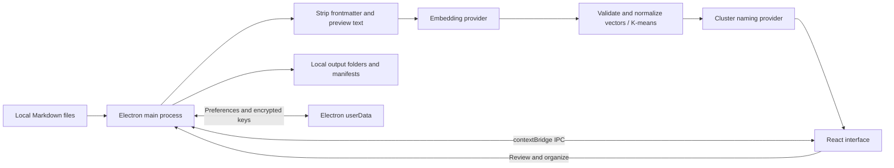

# Architecture

Status: implemented architecture, reviewed 19 September 2026. See [PRD](PRD.md) for future requirements and [validation](VALIDATION.md) for the limits of verified behavior.

## System and data flow

The app is Electron + Vite/React, not Next.js. There is no hosted application backend, vector database or Pinecone index upload. Pinecone is an optional remote embedding service. Namespace labels represent local directories/frontmatter, not a database connection.

## Components and responsibilities

| Component | Responsibility |
|---|---|
| `src/App.jsx` | Session state, import, clustering, manual review and export controls |
| `src/components/FileList.jsx` | Virtualized file previews using installed v2 list APIs |
| `electron/preload.js` | Explicit renderer API and modern Electron dropped-file path access |
| `electron/main.js` | Provider selection, IPC, credential persistence, import, embeddings, K-means, naming, export, document merge |
| `electron/mergeMarkdown.js` | Concatenate selected markdown files into one document. No model call. |
| `electron/local-models.js` | Loopback URL policy, bounded local requests and vector validation |
| `electron/export-service.js` | Exact export plans, staged payloads/backups, durable journals and guarded undo |
| `electron/library-service.js` | Versioned project snapshots, category examples and threshold-based assignment |
| `electron/embedding-cache.js` | Bounded session LRU of normalized vectors, keyed by endpoint/model/prepared input |
| `electron/jobs.js` / `clustering-worker.js` | Single active inference job, abort signals, worker K-means and fixed seed |
| `electron/recovery-store.js` / `src/hooks/useRecovery.js` | Atomic local draft snapshots, debounced saves and explicit startup recovery |
| `electron/logger.js` | Local diagnostic logs; file names/paths may be present |

Keep this desktop architecture. Extract import/export and clustering services incrementally when adding substantive features; a rewrite or server tier is not justified for a single owner.

## Provider resolution and offline boundary

Saved offline mode or `OFFLINE_MODE=true` forces naming and embeddings to local providers. Startup skips cloud-key validation. Local settings are saved in Electron userData and survive packaged launches without a `.env` file. Outside offline mode, saved provider choices override environment defaults, then OpenAI is the fallback default. Provider selection does not prove credentials or model capabilities; the local settings button tests both capabilities before saving.

Local calls use an OpenAI-compatible server on literal loopback (`localhost` is rewritten to `127.0.0.1`). Credentials in the URL, remote hosts, cloud model names, and redirects are rejected. Requests have a 120-second timeout and no automatic local retries. Local batches contain at most eight previews. There is no automatic cloud fallback. Pinecone E5 routing is available only when the OpenAI embedding route is selected; a stale E5 selector cannot override local embeddings.

This boundary controls this application's model requests. It cannot prevent a local server from proxying to the internet or control other applications. Use downloaded models and disable Ollama cloud features; verify with the network disconnected for the strongest practical check. Cloud mode deliberately sends previews to configured endpoints.

## Processing semantics

- Import reads complete supported files into memory, strips frontmatter only when preparing model input, and retains original paths. Files are not changed during clustering.
- Embeddings use at most 1,500 characters of prepared preview per file (exception: an unusually long extracted title may exceed this; backlog item). This is a prefix-based approximation, not whole-document semantic analysis.
- Vector counts, dimensions, finite values and nonzero vectors are validated. Vectors are normalized before Euclidean K-means, improving consistency between model families.
- K-means runs in a cancellable worker with seed 42. Suggested k is a heuristic, not a quality guarantee.
- Naming samples the first five files per cluster, up to 1,000 characters each. Failures produce generic cluster labels and local logs; clustering remains usable.
- Suggest k, clustering and category assignment share a bounded session embedding cache. No persistent vector database exists. Saved projects and recovery drafts resume review state, but in-flight model jobs cannot resume.

## Storage and exports

Copy is the default. Move modifies source locations. Export now stages backups and persists a recovery journal; undo restores original bytes if source/output paths have not been edited. The multi-file operation is recoverable but is not a filesystem-wide transaction. Export resolves paths beneath selected folders, generates collision suffixes for documents and cluster `_index.md`, and records actual successful destination paths in `index.json`. Per-cluster namespaces propagate to frontmatter. Partial errors are displayed by the UI. `index.json` describes the current export, while `_dedup_manifest.json` accumulates source-path/mtime entries. Deduplication is an optimization, not content identity or backup validation.

Source files and full contents cross IPC and remain in renderer memory. File reads/writes and snapshot serialization still execute on the main thread; large collections can freeze the UI. K-means runs in a cancellable worker. Path containment is lexical, not a complete symlink/race defense. Treat source documents and output directories as trusted local data until the hardening backlog is complete.

## Runtime and deployment

Electron bundles the runtime and built UI; Vite and npm are unnecessary when launching the packaged app. Ollama remains a separately installed running service. Initial dependency installation, building and model acquisition need connectivity or an already populated cache. Runtime operation with saved local settings and downloaded models needs no cloud service.

The runtime was upgraded from Electron 28 because the declared electron-store 11 requires Electron 30+. Consult the lockfile for exact tested versions. Signing/notarization and distribution to other computers are separate release work.

## Product workflow extension

See [Projects, categories and reversible export](PRODUCT_WORKFLOWS.md). The renderer previews export through IPC, receives a plan ID, and confirms that ID; the main process owns exact paths and staged content. Library snapshots deliberately omit credentials and vectors. Applying reusable categories re-embeds examples with the active model, constructs normalized centroids, and places weak/ambiguous matches in Uncertain. These services are independent of Electron and covered by filesystem regression tests.

## Document merge

**Merge into** groups files into one cluster. **Merge into one document** writes one new markdown file. Sources are left where they are.

Ctrl+click (or Cmd+click) selects files. On the file list, that selection is only for this merge. In Cluster View, the same selection also feeds Split. Section order is the order the files were selected. If the selection spans more than one cluster, the tip bar offers to merge every selected file.

`save-markdown-dialog` asks for the output path. `merge-markdown` calls `buildMergedMarkdown()` and writes that file. The document title is the filename without `.md`. The handler checks the path with `sanitizePath()` and refuses to write if the chosen path is an existing directory. The save dialog is the user's chosen destination, so the file is not forced under the organize output folder.

Each source becomes a `##` section. The section title comes from frontmatter `title`, otherwise the first heading, otherwise the filename. Source frontmatter is dropped. The combined file has one frontmatter block with `title` and `sources` (original paths), then an `#` heading of the document title. Headings inside a source stay as written.

No embedding or chat call is involved, so this works with no API key and in offline mode. A merged file can be large: the 1,500-character embedding trim does not apply.
